## What we do

**Research for organizations.** We study how a company really works and help it integrate and improve its internal processes, so its teams spend less time on friction and more time on results.

**Training for civil society.** We design practical, accessible learning programs that give people across Ecuador the skills to grow and take part.

**Outreach.** We share what we learn and promote knowledge through social media, so ideas travel further than a single workshop.

## Constellations

Our products are organized as **constellations**: focused, independent projects that each solve one problem well, communicate strictly over decoupled network protocols (REST, WebSocket/WSS, gRPC) without direct crate coupling, and share one standard of quality. They are published here as they become ready.

| Constellation | In one line |
| :-- | :-- |
| **Orion** | Protocol-agnostic universal Rust framework with factored schemas and patterns for web, server, and multi-device services. |
| **Andromeda** | Sovereign host protection daemon and operational security toolset for Linux VPS and future multi-OS infrastructure. |
| **Aurora** | Dynamic multi-device UI/UX rendering engine translating declarative agent-to-UI JSON into Web, mobile, and desktop interfaces. |
| **Pleaides** | Robotic organism mobility and actuation utility with hardware compatibility layers across diverse microcontrollers and chips. |
| **Pulsar** | Distributed multi-agent swarm orchestrator connecting server cores and Aurora clients over decoupled network protocols. |
| **Caelum** | Physical-world interaction, tactile perception, and full-body robotic motor coordination engine with multi-hardware compatibility layers. |
| **Lyra** | Multimodal sensory perception engine in pure Rust enabling agents to ingest audio, music, video, and human-like sensory streams. |

We also maintain **[Skills](https://github.com/natuleadan/skills)**, a catalog of installable agent skills paired with native Rust execution scripts.

## Project templates

We also publish four open project templates that share the same quality standards (pre-seeded with an example license so adopters can choose their own): [Rust](https://github.com/natuleadan/template-rs), [TypeScript](https://github.com/natuleadan/template-ts), [Python](https://github.com/natuleadan/template-py) and [Go](https://github.com/natuleadan/template-go).

NATULEADAN® is a registered brand. Open source projects are licensed under the Apache License 2.0.

